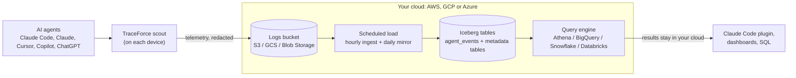

# TraceForce lakehouse

Query your AI-agent activity (Claude Code, Claude, Cursor, GitHub Copilot, ChatGPT) and
TraceForce findings in plain English, with SQL, or on ready-made dashboards. Everything runs in
your own cloud: one Terraform module sets up Iceberg tables, loaded hourly, on **AWS (Athena)**,
**AWS (Snowflake)**, **GCP (BigQuery)**, **Azure (Snowflake)** or **Azure (Databricks)**.

## Examples

In Claude Code:

| command | what it does |
|---|---|
| `/traceforce-lakehouse:traceforce-lakehouse` | Answers questions about agent activity in plain English, read-only, and drills down into specific prompts and tool calls. |
| `/traceforce-lakehouse:dashboards` | Opens the usage-and-spend and incident-triage dashboards in your browser. AWS (Athena), GCP, Azure (Databricks) and Snowflake (AWS or Azure). |

## What the plugin runs

Claude Code only (terminal, IDE, or the desktop app's Code tab): Claude chat and Cowork can't use your
computer's cloud sign-in. The query skill runs `skills/traceforce-lakehouse/scripts/`, which send read-only
SQL through your signed-in cloud CLI. The dashboards skill starts a local server on 127.0.0.1. Queries and
results stay between your computer and your cloud.

## What is in the lake

- `agent_events`: one row per log record or span from every agent scout writes telemetry for
  (e.g. Claude Code, Claude, Cursor, GitHub Copilot and ChatGPT),
  loaded hourly.
- Metadata tables mirrored daily from TraceForce: devices, accounts, installs,
  conversations, findings, issues, MCP inventory and catalog, user groups and IdP users. Columns
  and joins are documented in `skills/traceforce-lakehouse/reference/`.
- Logs are stored exactly as TraceForce writes them, with sensitive values redacted according
  to your policy. Finding evidence (the matched value itself) is never loaded; review it in
  the TraceForce console.



## Install

1. Deploy the Terraform module for your cloud ([Deploy](#deploy) below). It builds a queryable
   database (Iceberg tables, loaded hourly) in your own cloud over the agent activity TraceForce
   already writes to your storage. The easiest way to get the exact `main.tf` is the Lakehouse
   tile in TraceForce Settings.

2. Install the plugin in Claude Code (other agents: see [`AGENTS.md`](AGENTS.md)):

   ```
   /plugin marketplace add traceforce/traceforce-lakehouse
   /plugin install traceforce-lakehouse@traceforce
   ```

## Before you start

- TraceForce Settings has an S3, GCS, or Azure Blob Storage Provider configured: the
  bucket/container and prefix that TraceForce writes to. You will need these values.
- Terraform 1.5 or later.
- The cloud-specific requirements at the top of your cloud's section below.

## Deploy

<details>
<summary><b>AWS (Athena)</b></summary>

**Before you start:** a principal that can create S3 Tables, Glue, Athena, Step Functions and
IAM resources in that account; deploy in the bucket's region.

1. Create a root configuration. Keep the state in your own state bucket, never the logs bucket.

   ```hcl
   terraform {
     required_version = ">= 1.5"
     backend "s3" {
       bucket       = "acme-terraform-state"
       key          = "traceforce-lakehouse/terraform.tfstate"
       region       = "us-east-1"
     }
   }

   provider "aws" {
     region = "us-east-1" # the logs bucket's region
   }

   module "traceforce_lakehouse" {
     source      = "github.com/traceforce/traceforce-lakehouse//terraform/aws/athena?ref=1.8.0"
     logs_bucket = "acme-traceforce-logs"
     logs_prefix = "traceforce" # "" if TraceForce writes at the bucket root

     # logs_kms_key_arn        = "arn:aws:kms:..." # bucket encrypted with a customer-managed key
     # create_glue_integration = false             # apply says the Glue catalog s3tablescatalog already exists
     # alarm_sns_topic_arn     = "arn:aws:sns:..." # get notified when a scheduled run fails
     # query_trusted_principals = ["arn:aws:iam::OTHER_ACCOUNT_ID:root"] # a separate team (no access to this account) queries via an assumed role
   }

   output "query_policy_json" { value = module.traceforce_lakehouse.query_policy_json }
   ```

2. `terraform init && terraform apply`. If the bucket uses a customer-managed KMS key, set
   `logs_kms_key_arn` now; without it the hourly load fails with Access Denied.

3. Attach `terraform output -raw query_policy_json` to the IAM users or roles that will query.

   If a separate team **without access to this account** will query, instead set
   `query_trusted_principals` to their principal ARN(s) and hand them
   `terraform output -raw query_role_arn`; they assume that read-only role from their own
   AWS identity (a `role_arn` profile in `~/.aws/config`).

4. Install the skill in your coding agent. Claude Code:

   ```
   /plugin marketplace add traceforce/traceforce-lakehouse
   /plugin install traceforce-lakehouse@traceforce
   ```

   Any other agent (Cursor, Copilot, Codex): see [`AGENTS.md`](AGENTS.md). Then ask questions.

The first load runs within the hour and covers the last few days.

**Upgrading from 1.7.3 or earlier:** the module moved from `//terraform/aws` to
`//terraform/aws/athena`. Change `source` to the new path and run `terraform init -upgrade`. The
move itself changes no resources; from 1.7.3, `terraform plan` shows one addition, an HTTPS-only
policy on the Athena results bucket (new in 1.8.0). Bumping only
`?ref=` on the old path stops with an error naming the new path, before anything is planned.

</details>

<details>
<summary><b>AWS (Snowflake)</b></summary>

**Before you start:**

- The logs bucket and prefix from your TraceForce Storage Provider (TraceForce Settings).
- An existing Snowflake account **on AWS, in the logs bucket's region**: `SELECT CURRENT_REGION()`
  shows it, e.g. `AWS_US_EAST_1` for a bucket in us-east-1. A Snowflake account can't move to
  another region. The module refuses any other account at plan time, so the hourly loads never
  move the logs across regions.
- A key-pair Snowflake user to deploy with, whose session runs as `ACCOUNTADMIN`: either its
  default role, or `role = "ACCOUNTADMIN"` in the `snowflake` provider block as the snippet
  below does (resource monitors, integrations and external volumes need it). Deploying reads
  `SNOWFLAKE_PRIVATE_KEY` from the environment; the organization, account and user are plain
  provider arguments in the snippet.
- **That user has a default warehouse**: any existing warehouse it can use. Creating the Iceberg
  tables (and the grant that lets the failure alert read Task history) needs one in Terraform's
  own session, before the module's warehouse exists. It's used for seconds; everything afterwards
  runs on the module's warehouse, `traceforce_lakehouse`. Check with `DESC USER <deploy user>`
  (`DEFAULT_WAREHOUSE`); a trial account's first admin user has `COMPUTE_WH`. To set one:

  ```sql
  ALTER USER acmedeployuser SET DEFAULT_WAREHOUSE = COMPUTE_WH;
  ```

  Or name an existing warehouse in the provider block instead (`warehouse = "COMPUTE_WH"`).
- AWS credentials in that account, in the bucket's region, that can create, read and delete the
  module's bucket and IAM roles, and read the logs bucket's location: `s3:CreateBucket`,
  `s3:DeleteBucket`, `s3:DeleteBucketPolicy`, `s3:Get*`, `s3:Put*`, `s3:List*` and
  `s3:DeleteObject*` on `traceforce-lakehouse-iceberg-*`; `iam:CreateRole`, `iam:GetRole`,
  `iam:DeleteRole`, `iam:UpdateAssumeRolePolicy`, `iam:PutRolePolicy`, `iam:GetRolePolicy`,
  `iam:DeleteRolePolicy` and `iam:List*` on `traceforce-lakehouse-snowflake-*`;
  `s3:GetBucketLocation` and `s3:ListBucket` on the logs bucket. Tested only with an
  administrator, not as a minimal policy.
- Terraform 1.5 or later. Unlike Azure, there's no admin-consent step: Snowflake reaches your
  buckets through IAM roles the module creates.
- One deployment per AWS account and per Snowflake account: the IAM role names and the Snowflake
  object names are fixed, and IAM role names are account-wide, even across regions.

Not carried over from the Athena module: `alarm_sns_topic_arn` (failed runs are emailed by
Snowflake, `alarm_notification_email`), `create_glue_integration` (no Glue), and
`query_trusted_principals` (query access is a Snowflake role: `reader_users` or
`query_user_public_key`).

1. Create a root configuration. Keep the state in your own state bucket, never the logs bucket.

   ```hcl
   terraform {
     required_version = ">= 1.5"
     backend "s3" {
       bucket = "acme-terraform-state"
       key    = "traceforce-lakehouse/terraform.tfstate"
       region = "us-east-1"
     }
     required_providers {
       aws = {
         source  = "hashicorp/aws"
         version = ">= 6.44.0"
       }
       snowflake = {
         source  = "snowflakedb/snowflake"
         version = ">= 2.19.0, < 3.0.0"
       }
     }
   }

   provider "aws" {
     region = "us-east-1" # the logs bucket's region
   }

   provider "snowflake" {
     organization_name = "acmeorg"        # Snowsight account selector, top-left
     account_name      = "acmeaccount"    # the account name, not the account locator; on AWS in the logs bucket's region
     user              = "acmedeployuser" # the Snowflake user Terraform authenticates as; needs a default warehouse (above)
     role              = "ACCOUNTADMIN"   # the module creates a resource monitor, integrations and an external volume, which only this role can
     authenticator     = "SNOWFLAKE_JWT"  # key-pair auth; this module always uses it, not a choice

     # private_key is the one real secret here -- deliberately not set above like the rest:
     # reads from SNOWFLAKE_PRIVATE_KEY in the environment, never hardcoded in this file.

     # preview_features_enabled is required: several resource types this module needs (external
     # tables, Iceberg tables, email notifications, alerts) and the account lookup it uses to check
     # the region are still preview-status in the provider.
     preview_features_enabled = [
       "snowflake_external_table_resource",
       "snowflake_iceberg_table_resource",
       "snowflake_email_notification_integration_resource",
       "snowflake_alert_resource",
       "snowflake_current_account_datasource",
     ]
   }

   module "traceforce_lakehouse" {
     source      = "github.com/traceforce/traceforce-lakehouse//terraform/aws/snowflake?ref=1.8.0"
     logs_bucket = "acme-traceforce-logs"
     logs_prefix = "traceforce" # "" if TraceForce writes at the bucket root

     # logs_kms_key_arn           = "arn:aws:kms:..." # bucket encrypted with a customer-managed key
     # warehouse_size             = "SMALL"       # default XSMALL; the scheduled Tasks' warehouse: bump for a lookback_days catch-up
     # query_warehouse_size       = "SMALL"       # default XSMALL; the warehouse readers query on: bump if queries feel slow
     # alarm_notification_email   = "jdoe@acme.com" # a verified Snowflake user's email, not a team address -- get notified when a scheduled Task fails
     # query_user_public_key      = "MIIBIjAN..."  # one-line public key body: creates traceforce_lakehouse_query, a reader-only service user for step 3
     # reader_users               = ["JDOE"]       # exact stored Snowflake usernames (uppercase unless created quoted) granted read-only access
     # credit_notification_users  = ["JDOE"]       # exact stored usernames with verified emails, emailed as credit usage climbs (the monitor never suspends the warehouse)
     # dashboard_sign_in          = { console_origin = "https://<TraceForce console>", snowflake = {} } # TraceForce dashboards: viewers sign in to Snowflake (step 5)
   }

   output "reader_role_name" { value = module.traceforce_lakehouse.reader_role_name }
   # output "dashboard_settings" { value = module.traceforce_lakehouse.dashboard_settings } # with dashboard_sign_in (step 5)
   ```

2. `terraform init && terraform apply`. If the bucket uses a customer-managed KMS key, set
   `logs_kms_key_arn` now; without it the hourly load fails (see below). One apply
   creates everything: the Iceberg bucket `traceforce-lakehouse-iceberg-<account id>-<region>`,
   two IAM roles Snowflake assumes (`traceforce-lakehouse-snowflake-raw` reads only the two
   TraceForce subtrees of the logs bucket, `traceforce-lakehouse-snowflake-iceberg` writes only
   the Iceberg bucket), and in Snowflake the storage integration, two stages, external volume, two
   warehouses (`traceforce_lakehouse` for the scheduled Tasks, `traceforce_lakehouse_query` for
   readers' queries), tables and the scheduled Tasks. The first ingest runs at the next :57 past
   the hour (UTC); the metadata mirrors run daily at 12:30 UTC.

   If it stops on `Terraform's Snowflake session has no warehouse`, the deploy user has no default
   warehouse (see "Before you start"): set one, then run `terraform apply` again; it picks up
   where it stopped. If it stops on `The requested warehouse does not exist or not authorized`,
   the warehouse named in the provider block doesn't exist or the user can't use it.

   If a scheduled ingest later fails with `the raw telemetry external table has files in the
   ingest window but Snowflake could not read any of them`, Snowflake can list the logs but not
   read them. Usually the bucket uses SSE-KMS and `logs_kms_key_arn` isn't set (or the key policy
   doesn't allow it); otherwise check the `traceforce-lakehouse-snowflake-raw` role. CloudTrail
   shows the denied `kms:Decrypt` or `s3:GetObject` calls.

3. Grant query access. Querying should use a dedicated read-only user, not the user you
   deployed with (in practice `ACCOUNTADMIN`): handing a coding agent a key that broad is
   unnecessary exposure when the reader role is the only access querying needs. Generate a key
   pair for it and set `query_user_public_key` in step 1 to the public key's one-line body; the
   module creates `traceforce_lakehouse_query`, a service user that holds only the reader role,
   with secondary roles off, UTC and a 300 s statement timeout, so the identity itself is
   read-only whatever client connects. Or create the user yourself and grant the role:

   ```sql
   CREATE USER traceforce_query TYPE = SERVICE RSA_PUBLIC_KEY = '<public key>';
   GRANT ROLE "traceforce_lakehouse_reader" TO USER traceforce_query;
   ```

   (or, once it exists, list it in `reader_users` in step 1 and re-apply). The user needs no default
   warehouse: queries run on the module's query warehouse, `traceforce_lakehouse_query`. Either way,
   step 4's credentials are this user's, not the deploy user's. Keep them apart from the deploy key:
   step 1's provider reads `SNOWFLAKE_PRIVATE_KEY` too, so a later `terraform apply` in a shell
   holding the query user's key fails with an invalid JWT. Give the query user a `connections.toml`
   connection (the script uses it only when none of the five `SNOWFLAKE_*` variables is set), or
   export the deploy key again before applying.

4. Install the skill in your coding agent. Claude Code:

   ```
   /plugin marketplace add traceforce/traceforce-lakehouse
   /plugin install traceforce-lakehouse@traceforce
   ```

   Any other agent (Cursor, Copilot, Codex): see [`AGENTS.md`](AGENTS.md). Querying needs
   python3 with `snowflake-connector-python` and, as the step 3 user, either the five
   `SNOWFLAKE_*` environment variables (listed in `snowflake_query.sh`) or a `connections.toml`
   connection. Then ask questions.

5. Optional: the usage & spend and incident triage dashboards in TraceForce. Each viewer's browser
   queries Snowflake directly, as that viewer, with a token limited to the reader role; query
   results never pass through TraceForce. Set `dashboard_sign_in` in step 1, with
   `console_origin` the address you open TraceForce at (Settings › Lakehouse shows the line to
   paste), and choose how viewers sign in:

   - `snowflake = {}`: on Snowflake's own sign-in page (password, MFA or the account's SSO). The
     module creates a Snowflake OAuth integration named `Lakehouse` (a public client with PKCE,
     limited to the reader role, secondary roles off, sign-in kept for `refresh_token_validity`
     seconds, default 24 hours) and a small Lambda function,
     `traceforce-lakehouse-dashboard-relay`, with a function URL: browsers can't read
     Snowflake's token endpoint (it sends no CORS headers), so the dashboard sends the sign-in's
     token request there and it forwards it to your account. It keeps nothing and logs only the
     grant type and status. Optionally `relay_concurrency = <n>` reserves that much Lambda
     concurrency for it, so a flood of requests can't use up the account's shared concurrency
     (AWS allows at most the account's unreserved concurrency minus 100, so not on an account
     whose limit is 100 or less). The deploy credentials also need, beyond "Before you start":
     the same IAM actions plus `iam:PassRole` on `traceforce-lakehouse-dashboard-relay`,
     `lambda:*` on the function `traceforce-lakehouse-dashboard-relay` and `logs:*` on the log
     group `/aws/lambda/traceforce-lakehouse-dashboard-relay`, and `logs:DescribeLogGroups` on
     `*` (it can't be limited to a log group; the provider reads the group with it). Tested only
     with an administrator.
   - `external = { provider = "entra", tenant_id = "...", audience = "api://..." }` (or `"okta"`
     / `"custom"` with `issuer`): through your company's identity provider, with Snowflake
     External OAuth. No relay; the identity provider's app registration is yours to create, with
     a delegated scope `session:scope:TRACEFORCE_LAKEHOUSE_DASHBOARD` (Entra, whose resource app
     must leave `accessTokenAcceptedVersion` unset: the module trusts its v1 tokens; Okta:
     `session:role:TRACEFORCE_LAKEHOUSE_DASHBOARD`; only Entra is tested). These viewers query
     as `TRACEFORCE_LAKEHOUSE_DASHBOARD`, a role the module creates with the reader role's
     access and nothing more: an identity provider can't name the lowercase reader role. Each
     needs a Snowflake user whose login name matches the token's `upn` (Entra) or `sub` claim.

   Either way, each viewer needs a Snowflake user that holds the reader role, or for `external`
   `TRACEFORCE_LAKEHOUSE_DASHBOARD`; the module grants each to `reader_users`.
   Uncomment the `dashboard_settings` output in step 1 too, re-apply, then paste
   `terraform output -json dashboard_settings` into Settings › Lakehouse.
   On first sign-in, Snowflake asks the viewer to allow `Lakehouse` access with the reader role.

**Catch-up:** each hourly ingest reads the last `lookback_days` upload days (default 3). After an
outage, raise `lookback_days`, apply, let one hourly run finish (`TASK_HISTORY`, see
[Is it working](#is-it-working)), then set it back; for a long catch-up, raise it in steps or
raise `warehouse_size` for it.

**Removing it:** `terraform destroy` removes everything the module created, including the
Iceberg bucket and its files. A new deployment reloads `agent_events` from the raw logs still in
the logs bucket (the last `lookback_days` upload days, more if you raise it as for a catch-up);
history whose raw logs are gone is lost for good. The logs bucket is never changed.

</details>

<details>
<summary><b>GCP (BigQuery)</b></summary>

**Before you start:** the gcloud CLI signed in (`gcloud auth login` + `gcloud auth
application-default login`) on the project that owns the bucket, as an identity that can create
BigQuery datasets/connections/transfers and a service account, set IAM, and enable the BigQuery
APIs — in practice **project Owner**.

1. Create a root configuration, keeping state in your own GCS bucket, never the logs bucket.

   ```hcl
   terraform {
     required_version = ">= 1.5"
     backend "gcs" {
       bucket = "acme-terraform-state"
       prefix = "traceforce-lakehouse"
     }
   }

   provider "google" {
     project = "acme-prod-482913" # the project that owns the bucket and runs BigQuery
   }

   module "traceforce_lakehouse" {
     source      = "github.com/traceforce/traceforce-lakehouse//terraform/gcp?ref=1.8.0"
     logs_bucket = "acme-traceforce-logs"
     logs_prefix = "traceforce" # "" if TraceForce writes at the bucket root

     # query_members = ["group:security@acme.com"] # a separate team gets read-only query access (they also need roles/bigquery.jobUser in their own project)
   }
   ```

   The dataset location is derived from the logs bucket — you do not set it.

2. `terraform init && terraform apply`.

3. Install the skill (Claude Code: the two `/plugin` commands above; other agents: see
   [`AGENTS.md`](AGENTS.md)). Set the lakehouse's project as your gcloud default
   (`gcloud config set project <id>`), then ask questions. Tables live in the
   `traceforce_lakehouse` dataset.

   The first load runs within the hour and covers the last few days.

</details>

<details>
<summary><b>Azure (Snowflake)</b></summary>

**Before you start:**

- The logs storage account's resource group (not shown in TraceForce Settings), and a globally
  unique 3-24 character lowercase name for the storage account the module creates.
- An existing Snowflake account on Azure, in the logs storage account's region (anywhere else
  pays cross-region egress on every load and query), with a key-pair user whose session runs as
  `ACCOUNTADMIN`: either its default role, or `role = "ACCOUNTADMIN"` in the `snowflake`
  provider block as the snippet below does (resource monitors, integrations and external volumes
  need it). Deploying reads `SNOWFLAKE_PRIVATE_KEY` from the environment; the organization,
  account and user are plain provider arguments in the snippet.
- The Azure CLI signed in (`az login`) as an identity that can create a storage account and role
  assignments in the logs resource group — **Owner**, or **User Access Administrator** +
  **Storage Account Contributor** on that group (the module creates its own storage account
  there for the Iceberg data). The subscription and tenant IDs are provider arguments too
  (`az account show --query "{id:id,tenantId:tenantId}"`).
- The first deployment against a Snowflake account/tenant pair needs a Microsoft Entra admin to
  grant admin consent (step 3 below); subscription roles like Owner don't include that. With
  `use_azuread_auth`, the state storage account also needs `Storage Blob Data Contributor`.
- The `Microsoft.Storage` resource provider registered in the subscription
  (`az provider register --namespace Microsoft.Storage`, by someone with Contributor or Owner on
  the subscription). Roles on the resource group can't register providers, so the `azurerm`
  provider below sets `resource_provider_registrations = "none"` rather than trying.

1. Create a root configuration. Keep the state in your own state storage account, never the
   logs storage account.

   ```hcl
   terraform {
     required_version = ">= 1.5"
     backend "azurerm" {
       subscription_id      = "00000000-0000-0000-0000-000000000000" # az account show --query id -o tsv
       tenant_id            = "00000000-0000-0000-0000-000000000000" # az account show --query tenantId -o tsv
       resource_group_name  = "acme-terraform-rg"
       storage_account_name = "acmetfstate"
       container_name       = "tfstate"
       key                  = "traceforce-lakehouse/terraform.tfstate"
       use_azuread_auth     = true
     }
     required_providers {
       azurerm = {
         source  = "hashicorp/azurerm"
         version = ">= 4.31.0, < 5.0.0"
       }
       azuread = {
         source  = "hashicorp/azuread"
         version = "~> 3.0"
       }
       snowflake = {
         source  = "snowflakedb/snowflake"
         version = ">= 2.19.0, < 3.0.0"
       }
     }
   }

   provider "azurerm" {
     subscription_id = "00000000-0000-0000-0000-000000000000" # az account show --query id -o tsv
     tenant_id       = "00000000-0000-0000-0000-000000000000" # az account show --query tenantId -o tsv
     # Don't auto-register Azure resource providers: that needs subscription-level rights the
     # deployer may not have. Register the ones this module needs beforehand (README, "Before you start").
     resource_provider_registrations = "none"
     features {}
   }

   # tenant_id pins this to the same directory as azurerm, rather than whichever tenant the
   # Azure CLI's current context happens to default to.
   provider "azuread" {
     tenant_id = "00000000-0000-0000-0000-000000000000" # az account show --query tenantId -o tsv
   }

   provider "snowflake" {
     organization_name = "acmeorg"        # Snowsight account selector, top-left
     account_name      = "acmeaccount"    # the account name, not the account locator
     user              = "acmedeployuser" # the Snowflake user Terraform authenticates as
     role              = "ACCOUNTADMIN"   # the module creates a resource monitor, integrations and an external volume, which only this role can
     authenticator     = "SNOWFLAKE_JWT"  # key-pair auth; this module always uses it, not a choice

     # private_key is the one real secret here -- deliberately not set above like the rest:
     # reads from SNOWFLAKE_PRIVATE_KEY in the environment, never hardcoded in this file.

     # preview_features_enabled is required: several resource types this module needs (external
     # tables, Iceberg tables, email notifications, alerts) are still preview-status in the
     # provider.
     preview_features_enabled = [
       "snowflake_external_table_resource",
       "snowflake_iceberg_table_resource",
       "snowflake_email_notification_integration_resource",
       "snowflake_alert_resource",
     ]
   }

   module "traceforce_lakehouse" {
     source = "github.com/traceforce/traceforce-lakehouse//terraform/azure/snowflake?ref=1.8.0"

     # Must be globally unique across all of Azure (storage account names share one namespace
     # account-wide) and stable for the life of the deployment: changing it later destroys and
     # recreates the storage account, deleting the Iceberg table files.
     iceberg_storage_account_name = "acmetraceforcelakehouse"

     logs_storage_account_name = "acmetraceforcelogs"
     logs_resource_group_name  = "acme-logs-rg"
     logs_container_name       = "logs"
     logs_prefix               = "traceforce" # "" if TraceForce writes at the container root

     # warehouse_size             = "SMALL"       # default XSMALL; the scheduled Tasks' warehouse: bump for a lookback_days catch-up
     # query_warehouse_size       = "SMALL"       # default XSMALL; the warehouse readers query on: bump if queries feel slow
     # alarm_notification_email   = "jdoe@acme.com" # a verified Snowflake user's email, not a team address -- get notified when a scheduled Task fails
     # query_user_public_key      = "MIIBIjAN..."  # one-line public key body: creates traceforce_lakehouse_query, a reader-only service user for step 5
     # reader_users               = ["JDOE"]       # exact stored Snowflake usernames (uppercase unless created quoted) granted read-only access
     # credit_notification_users  = ["JDOE"]       # exact stored usernames with verified emails, emailed as credit usage climbs (the monitor never suspends the warehouse)
     # dashboard_sign_in          = { console_origin = "https://<TraceForce console>", snowflake = {} } # TraceForce dashboards: viewers sign in to Snowflake (step 6)
   }

   output "azure_consent_url" { value = module.traceforce_lakehouse.azure_consent_url }
   output "reader_role_name" { value = module.traceforce_lakehouse.reader_role_name }
   # output "dashboard_settings" { value = module.traceforce_lakehouse.dashboard_settings } # with dashboard_sign_in (step 6)
   ```

2. `terraform init && terraform apply`. The very first time this module deploys against a given
   Snowflake account + Azure tenant pair, expect this apply to get partway through and then stop
   on an error naming a consent URL: Snowflake creates its own Azure AD service principal to
   read/write your storage, and it can't be granted a role assignment until an Azure AD admin
   has consented to it. That's expected, not a failure — a redeploy later (even a full
   `destroy` + `apply`) won't hit it again, since consent is tied to the Snowflake
   account/tenant pair, not to this particular deployment.

3. Open the consent URL the error printed (or `terraform output -raw azure_consent_url`) and
   grant admin consent, then run `terraform apply` again. It completes the rest of the module
   this time — role assignments, the Iceberg tables, and the scheduled ingest/export Tasks. If
   it stops on the same consent error right after you consented, don't consent again: Azure can
   take an hour or longer to create Snowflake's service principal. Wait an hour or two, then
   re-run `terraform apply`.

4. Grant query access. Querying should use a dedicated read-only user, not the user you
   deployed with (in practice `ACCOUNTADMIN`): handing a coding agent a key that broad is
   unnecessary exposure when the reader role is the only access querying needs. Generate a key
   pair for it and set `query_user_public_key` in step 1 to the public key's one-line body; the
   module creates `traceforce_lakehouse_query`, a service user that holds only the reader role,
   with secondary roles off, UTC and a 300 s statement timeout, so the identity itself is
   read-only whatever client connects. Or create the user yourself and grant the role:

   ```sql
   CREATE USER traceforce_query TYPE = SERVICE RSA_PUBLIC_KEY = '<public key>';
   GRANT ROLE "traceforce_lakehouse_reader" TO USER traceforce_query;
   ```

   (or, once it exists, list it in `reader_users` in step 1 and re-apply). The user needs no default
   warehouse: queries run on the module's query warehouse, `traceforce_lakehouse_query`. Either way,
   step 5's credentials are this user's, not the deploy user's. Keep them apart from the deploy key:
   step 1's provider reads `SNOWFLAKE_PRIVATE_KEY` too, so a later `terraform apply` in a shell
   holding the query user's key fails with an invalid JWT. Give the query user a `connections.toml`
   connection (the script uses it only when none of the five `SNOWFLAKE_*` variables is set), or
   export the deploy key again before applying.

5. Install the skill in your coding agent. Claude Code:

   ```
   /plugin marketplace add traceforce/traceforce-lakehouse
   /plugin install traceforce-lakehouse@traceforce
   ```

   Any other agent (Cursor, Copilot, Codex): see [`AGENTS.md`](AGENTS.md). Querying needs
   python3 with `snowflake-connector-python` and, as the step 4 user, either the five
   `SNOWFLAKE_*` environment variables (listed in `snowflake_query.sh`) or a `connections.toml`
   connection. Then ask questions.

6. Optional: the usage & spend and incident triage dashboards in TraceForce. Each viewer's browser
   queries Snowflake directly, as that viewer, with a token limited to the reader role; query
   results never pass through TraceForce. Set `dashboard_sign_in` in step 1, with
   `console_origin` the address you open TraceForce at (Settings › Lakehouse shows the line to
   paste), and choose how viewers sign in:

   - `snowflake = {}`: on Snowflake's own sign-in page (password, MFA or the account's SSO). The
     module creates a Snowflake OAuth integration named `Lakehouse` (a public client with PKCE,
     limited to the reader role, secondary roles off, sign-in kept for `refresh_token_validity`
     seconds, default 24 hours) and a small Azure Function on a Flex Consumption plan (with its
     own storage account and a user-assigned identity that can only reach it): browsers can't
     read Snowflake's token endpoint (it sends no CORS headers), so the dashboard sends the
     sign-in's token request there and it forwards it to your account. It keeps nothing and logs
     only the grant type and status. Terraform publishes the Function's code with `az
     functionapp deployment source config-zip`, so the Azure CLI must be signed in to the
     subscription when you apply. It also needs more than "Before you start" lists: the
     `Microsoft.Web` and `Microsoft.ManagedIdentity` resource providers registered, and
     **Contributor** (or **Owner**) on the logs resource group, not just Storage Account
     Contributor, to create the Function app, its plan and the identity (User Access
     Administrator still covers the role assignment).
   - `external = { provider = "entra", tenant_id = "...", audience = "api://..." }` (or `"okta"`
     / `"custom"` with `issuer`): through your company's identity provider, with Snowflake
     External OAuth. No relay; the identity provider's app registration is yours to create, with
     a delegated scope `session:scope:TRACEFORCE_LAKEHOUSE_DASHBOARD` (Entra, whose resource app
     must leave `accessTokenAcceptedVersion` unset: the module trusts its v1 tokens; Okta:
     `session:role:TRACEFORCE_LAKEHOUSE_DASHBOARD`; only Entra is tested). These viewers query
     as `TRACEFORCE_LAKEHOUSE_DASHBOARD`, a role the module creates with the reader role's
     access and nothing more: an identity provider can't name the lowercase reader role. Each
     needs a Snowflake user whose login name matches the token's `upn` (Entra) or `sub` claim.

   Either way, each viewer needs a Snowflake user that holds the reader role, or for `external`
   `TRACEFORCE_LAKEHOUSE_DASHBOARD`; the module grants each to `reader_users`.
   Uncomment the `dashboard_settings` output in step 1 too, re-apply, then paste
   `terraform output -json dashboard_settings` into Settings › Lakehouse.
   On first sign-in, Snowflake asks the viewer to allow `Lakehouse` access with the reader role.

The first load runs within the hour and covers the last few days.

</details>

<details>
<summary><b>Azure (Databricks)</b></summary>

**Before you start:**

- The logs storage account's resource group (not shown in TraceForce Settings), and a globally
  unique 3-24 character lowercase name for the storage account the module creates for the
  Iceberg data. The logs storage account must be ADLS Gen2 (hierarchical namespace enabled).
- A name for the Databricks workspace the module creates (Premium, serverless) in the logs
  resource group and region. `terraform destroy` deletes this workspace and everything in it.
- A service principal (Entra app registration with a client secret) to deploy with, used for
  every `terraform apply`, with **Contributor** and **Role Based Access Control Administrator**
  (or **User Access Administrator**) on the logs resource group, and `Storage Blob Data
  Contributor` on the state storage container.
- Deploying reads its `ARM_CLIENT_ID`, `ARM_CLIENT_SECRET`, `ARM_TENANT_ID` and
  `ARM_SUBSCRIPTION_ID` from the environment. Keep the secret out of `main.tf`, and don't use it
  to query: it owns the lakehouse.
- The `Microsoft.Databricks` and `Microsoft.Storage` resource providers registered in the
  subscription (`az provider register --namespace <name>`, by someone with Contributor or Owner
  on the subscription). The deployer's resource-group roles can't register providers, so the
  `azurerm` provider below sets `resource_provider_registrations = "none"` rather than trying.
- One lakehouse per Azure region and per resource group.

1. Create a root configuration. Keep the state in your own state storage account, never the
   logs storage account.

   ```hcl
   terraform {
     required_version = ">= 1.5"
     backend "azurerm" {
       subscription_id      = "00000000-0000-0000-0000-000000000000" # az account show --query id -o tsv
       tenant_id            = "00000000-0000-0000-0000-000000000000" # az account show --query tenantId -o tsv
       resource_group_name  = "acme-terraform-rg"
       storage_account_name = "acmetfstate"
       container_name       = "tfstate"
       key                  = "traceforce-lakehouse-databricks/terraform.tfstate"
       use_azuread_auth     = true
     }
     required_providers {
       azurerm = {
         source  = "hashicorp/azurerm"
         version = ">= 4.9.0, < 5.0.0"
       }
       azapi = {
         source  = "Azure/azapi"
         version = ">= 2.13.0, < 3.0.0"
       }
       databricks = {
         source  = "databricks/databricks"
         version = ">= 1.141.0, < 2.0.0"
       }
     }
   }

   provider "azurerm" {
     subscription_id = "00000000-0000-0000-0000-000000000000" # az account show --query id -o tsv
     tenant_id       = "00000000-0000-0000-0000-000000000000" # az account show --query tenantId -o tsv
     # Don't auto-register Azure resource providers: that needs subscription-level rights the
     # deployer may not have. Register the ones this module needs beforehand (README, "Before you start").
     resource_provider_registrations = "none"
     features {}
   }

   # Creates the serverless workspace (azurerm has no setting for it). Same subscription and tenant.
   provider "azapi" {
     subscription_id = "00000000-0000-0000-0000-000000000000" # az account show --query id -o tsv
     tenant_id       = "00000000-0000-0000-0000-000000000000" # az account show --query tenantId -o tsv
   }

   # The workspace the module creates. Signs in with the same Azure identity as azurerm (the ARM_* variables).
   provider "databricks" {
     host                        = module.traceforce_lakehouse.databricks_workspace_url
     azure_workspace_resource_id = module.traceforce_lakehouse.databricks_workspace_id
   }

   module "traceforce_lakehouse" {
     source = "github.com/traceforce/traceforce-lakehouse//terraform/azure/databricks?ref=1.8.0"

     # Must be globally unique across all of Azure (storage account names share one namespace
     # account-wide) and stable for the life of the deployment: changing it later destroys and
     # recreates the storage account, deleting the Iceberg table files.
     iceberg_storage_account_name = "acmetraceforcelakehouse"

     # The Premium workspace this module creates in logs_resource_group_name. Stable for the life of
     # the deployment: changing it later replaces the workspace and everything in it.
     databricks_workspace_name = "acme-traceforce-lakehouse"

     logs_storage_account_name = "acmetraceforcelogs" # ADLS Gen2 (hierarchical namespace enabled)
     logs_resource_group_name  = "acme-logs-rg"
     logs_container_name       = "logs"
     logs_prefix               = "traceforce" # "" if TraceForce writes at the container root

     # ingest_warehouse_size    = "Small"                  # default 2X-Small; bump for a lookback_days catch-up
     # query_warehouse_size     = "Small"                  # default 2X-Small; bump if ad-hoc queries feel slow
     # query_max_num_clusters   = 2                        # default 1; raise if queries queue behind each other
     # query_auto_stop_mins     = 10                       # default 1; minutes idle before the query warehouse stops (fewer cold starts, more cost)
     # databricks_account_id    = "00000000-0000-0000-0000-000000000000" # optional; unset = read from the workspace (Public Beta data source). Account console, top-right menu.
     # alarm_notification_email = "jdoe@acme.com"          # get notified when a scheduled job fails or data goes stale
     # reader_user_names              = ["jdoe@acme.com"]    # read-only access: users (email)
     # reader_group_names             = ["security-team"]    # ... account groups
     # reader_service_principal_names = ["<application id>"] # ... service principals, e.g. a read-only identity for Claude Code
     # reader_can_view_jobs           = true                 # also let readers see the jobs' run history (default false)
     # lookback_days            = 7                        # default 3; raise only for a manual catch-up, then set it back
   }

   output "databricks_workspace_url" { value = module.traceforce_lakehouse.databricks_workspace_url }
   output "databricks_workspace_id" { value = module.traceforce_lakehouse.databricks_workspace_id }
   output "query_warehouse_id" { value = module.traceforce_lakehouse.query_warehouse_id }
   ```

2. `terraform init && terraform apply`, as the service principal. If the first apply stops
   while creating the SQL warehouses, run `terraform apply` again; don't destroy first.

3. The service principal is the workspace's only admin. Someone with **Contributor** or **Owner**
   on the subscription clicks **Launch Workspace** on the workspace in the Azure portal to become
   an admin too.

4. Grant query access. In the workspace, under Settings › Identity and access, add each reader
   with **Databricks SQL access**. Then list them in step 1's `reader_*` inputs and apply again as
   the service principal. Access can take about 5 minutes.

5. Install the skill in your coding agent (Claude Code: the two `/plugin` commands above; other
   agents: see [`AGENTS.md`](AGENTS.md)). Set `DATABRICKS_HOST` and `TRACEFORCE_LAKEHOUSE_WAREHOUSE_ID`
   to the `databricks_workspace_url` and `query_warehouse_id` outputs, then `az login` as the
   reader. Tables live in `traceforce_lakehouse.traceforce`.

The first load runs within the hour and covers the last few days; the metadata tables fill at the
daily mirror, 12:30 UTC.

</details>

## How it works

Everything runs in your own cloud: the tables, the hourly load and the queries. **Athena or
Snowflake over Iceberg in AWS (S3)**, **BigQuery over Iceberg in GCP (GCS)**, **Snowflake over
Iceberg in Azure (Blob Storage)**, or **Databricks over Iceberg in Azure (ADLS Gen2)**. Your
lakehouse is set up on one of them.

The daily metadata snapshots (findings, catalogs, and more) are written into your bucket or
container by TraceForce's storage role, under the grant you already gave it.

Query results never leave your cloud. They go to a bucket the module owns on AWS (Athena), and
to Snowflake-, BigQuery- or Databricks-managed result storage on the other engines. TraceForce
can read none of them.

## Is it working

- Freshness: `SELECT max(ingested_at), max(upload_ts) FROM agent_events` (on Snowflake,
  quoted: `SELECT max("ingested_at"), max("upload_ts") FROM "agent_events"`). More than two hours
  behind the newest object in your bucket means a run is failing or the schedule is disabled;
  if neither, contact TraceForce.
- **AWS (Athena):** the CloudWatch alarm `traceforce-lakehouse-runs-failed` raises on any failed
  scheduled run; set `alarm_sns_topic_arn` to be notified. The cause is in the Step Functions
  execution history.
- **GCP:** failed loads show in the BigQuery Data Transfer console — the two scheduled queries
  that ingest `agent_events` and mirror the metadata tables. The metadata mirror is a MERGE, so
  re-running it loads nothing twice. Until scout's first upload lands, the hourly ingest fails
  with "Cannot query hive partitioned data ... without any associated files"; that is expected on
  a new deployment and clears on its own once the first object arrives.
- **Snowflake (AWS or Azure):** `SELECT * FROM TABLE("traceforce_lakehouse".INFORMATION_SCHEMA.TASK_HISTORY(DATABASE_NAME => '"traceforce_lakehouse"', SCHEMA_NAME => '"traceforce"', ERROR_ONLY => TRUE, RESULT_LIMIT => 10000))`
  in Snowsight (with a warehouse active) shows every failed scheduled Task of the last 7 days (the
  hourly ingest, or any of the daily export mirrors) with Snowflake's own error message; set
  `alarm_notification_email` to also get emailed. The metadata mirrors are each a MERGE, so
  re-running one loads nothing twice, and one
  table failing never blocks the others (they're independent Tasks).
- **Azure (Databricks):** `SELECT * FROM traceforce_lakehouse.traceforce.freshness` on the
  `traceforce-lakehouse` warehouse shows one row per table, whether it's stale and why. Failed
  scheduled runs show in the workspace's Jobs & Pipelines: `traceforce-lakehouse-ingest` (hourly)
  and `traceforce-lakehouse-mirror` (daily, one task per metadata table), with Databricks' own
  error message; set `alarm_notification_email` to also get emailed when a job fails or data goes
  stale.

## More

- `docs/EXPORT_CONTRACT.md`: the snapshot format TraceForce writes into your bucket.
- Licence: Apache 2.0, see `LICENSE`.
